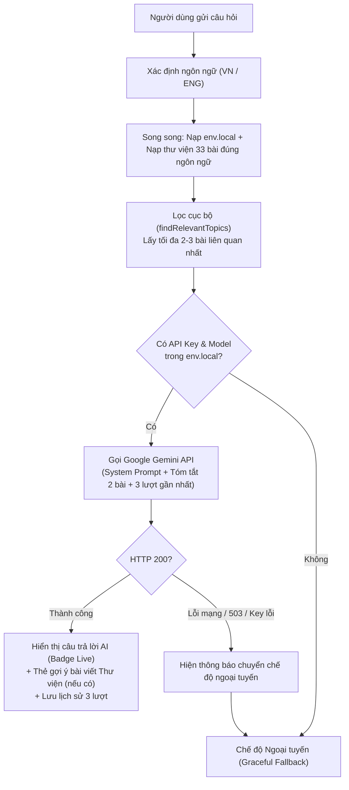
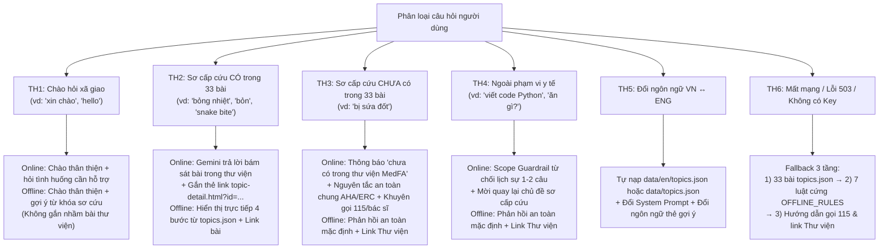

# THIẾT KẾ & HƯỚNG DẪN KHỞI CHẠY CHATBOT AI MEDFA (GOOGLE GEMINI + OFFLINE RAG)

> **Dự án:** MedFA – Nền tảng Học tập & Tra cứu Sơ cấp cứu trong "4 Phút Vàng"  
> **Môn học:** IE104 – Internet và Công nghệ Web (UIT – ĐHQG-HCM)  
> **Module chính:** `js/chatbot-gemini.js`  
> **Kiến trúc:** 100% Frontend thuần (Zero-dependency Vanilla JS + Google Gemini REST API + Client-side RAG 33 bài song ngữ)

---

## 1. HƯỚNG DẪN KHỞI CHẠY NHANH (QUICK START)

### Bước 1: Tạo tệp cấu hình môi trường `env.local`
Sao chép tệp mẫu `env.example` ở thư mục gốc dự án thành `env.local`:

```bash
# Windows (PowerShell)
Copy-Item env.example env.local

# macOS / Linux
cp env.example env.local
```

Mở tệp `env.local` và điền API Key lấy miễn phí từ [Google AI Studio](https://aistudio.google.com/app/apikey):

```env
GEMINI_API_KEY=AIzaSy...khoa_api_cua_ban...
GEMINI_DEFAULT_MODEL=gemini-3.5-flash-lite
```

> **Bảo mật:** Cả `env.local` và `.env` đều đã được liệt kê trong `.gitignore` để tuyệt đối không đẩy API Key lên GitHub.

### Bước 2: Khởi chạy website (Frontend tĩnh)
Chọn **1 trong 2 cách** dưới đây:

- **Cách 1 — VS Code Live Server (Khuyên dùng, tiện nhất):**
  1. Cài extension **Live Server** trong VS Code.
  2. Mở `index.html` → bấm **Go Live** ở góc dưới bên phải (mở tại `http://127.0.0.1:5500`).
  3. Chatbot tự động đọc `env.local` và chạy chế độ **Gemini Live** ngay lập tức.

- **Cách 2 — Static Server bằng Python (1 dòng lệnh):**
  ```bash
  python -m http.server 5505
  ```
  Sau đó mở trình duyệt tại `http://127.0.0.1:5505`.

### Bước 3: Kiểm tra & đổi Model AI trên giao diện
1. Bấm nút **Trợ lý AI** (biểu tượng robot góc dưới bên phải màn hình).
2. Bấm biểu tượng **Cài đặt (⚙️)** trên thanh tiêu đề màu xanh của khung chat để mở modal **Cài Đặt Mô Hình AI**.
3. Chọn 1 trong 4 model Gemini miễn phí và bấm **Lưu Cài Đặt** (hoặc bấm **Mặc định** để quay lại `GEMINI_DEFAULT_MODEL` trong `env.local`):

| Tên hiển thị | Mã Model API | Đặc điểm |
| :--- | :--- | :--- |
| **Gemini 3.5 Flash Lite** | `gemini-3.5-flash-lite` | Cân bằng tốt giữa tốc độ và chất lượng trả lời |
| **Gemini 3.1 Flash Lite** | `gemini-3.1-flash-lite` | Phản hồi rất nhanh (~1.8s), phù hợp hỏi đáp tức thời |
| **Gemini 3.6 Flash** | `gemini-3.6-flash` | Xử lý ngữ cảnh phong phú hơn |
| **Gemini 3.8 Flash** | `gemini-3.8-flash` | Khả năng suy luận cao (có thể gặp 503 lúc cao điểm) |

---

## 2. KHI NÀO DÙNG `env.local` VÀ KHI NÀO DÙNG `.env`?

Trong `js/chatbot-gemini.js`, hàm `loadEnvConfig()` tự động thử nạp theo thứ tự ưu tiên: **`env.local` → `.env`**.

| Trường hợp sử dụng | Tệp / Cách cấu hình | Lý do kỹ thuật & Cơ chế |
| :--- | :---: | :--- |
| **Triển khai trên Vercel (Production)** | **Environment Variables trên Vercel** (`GEMINI_API_KEY`) | Tự động kích hoạt qua Vercel Serverless Function `api/chat.js`. API Key được giữ bí mật 100% tại server, không lộ xuống trình duyệt. |
| **Chạy bằng VS Code Live Server ("Go Live" — port 5500)** | **`env.local`** *(Khuyên dùng)* | VS Code Live Server mặc định **chặn file ẩn bắt đầu bằng dấu chấm** (`.env` trả về 404). `env.local` không có dấu chấm ở đầu nên đọc được 100%. |
| **Chạy bằng Python `http.server` / Node static server** | `env.local` hoặc `.env` | Cả hai đều đọc được bình thường; dùng `env.local` để đồng bộ với Live Server. |
| **Đẩy mã nguồn lên GitHub (GitHub Pages)** | **Không đẩy file chứa key** (chỉ giữ `env.example`) | `.gitignore` đã chặn sẵn `env.local` và `.env` để tránh lộ API Key công khai. Khi chạy trên GitHub Pages, chatbot tự chuyển mượt sang **Chế độ Offline 33 bài**. |
| **Mở trực tiếp bằng giao thức `file:///`** | Không đọc được file cấu hình qua `fetch()` | Trình duyệt chặn CORS với `file:///`; chatbot tự kích hoạt **7 kịch bản phản xạ AHA/ERC nội tuyến**. |

---

## 3. KIẾN TRÚC & CƠ CHẾ HOẠT ĐỘNG

Chatbot MedFA được thiết kế theo mô hình **Hybrid AI + Client-side Lightweight RAG + 3-Layer Graceful Fallback**:

1. **Quản lý cấu hình động (Không hardcode model):**
   - `GEMINI_API_KEY` và `GEMINI_DEFAULT_MODEL` được nạp động từ `env.local` (fallback `.env`).
   - Lựa chọn model của người dùng được lưu vào `localStorage` (`medfa_gemini_model`).
   - Endpoint API được lắp ghép động: `.../v1beta/models/${model}:generateContent`.
2. **Client-side Lightweight RAG (Đọc ít bài liên quan nhất, không nhồi hết 33 bài):**
   - Tải và cache danh sách 33 bài từ `data/topics.json` (khi web ở **Tiếng Việt**) hoặc `data/en/topics.json` (khi web ở **Tiếng Anh**).
   - Bộ lọc `findRelevantTopics()` chấm điểm cục bộ theo tiêu đề và mô tả:
     - **Tôn trọng dấu thanh** khi người dùng gõ có dấu tiếng Việt (tránh khớp nhầm kiểu `"sứa"` ↔ `"sữa"`).
     - **Hỗ trợ gõ không dấu**, lỗi gõ thiếu 1 ký tự cuối (vd: `"bỏn"` → `"bỏng"`) và từ ghép tiếng Anh (`"snake bite"` → `"snakebite"`).
     - Loại bỏ từ đệm/xã giao (`STOP_WORDS`) để tránh khớp nhầm khi người dùng chỉ chào hỏi.
   - Chỉ trích tóm tắt tối đa **2 bài khớp nhất** gửi kèm Gemini làm ngữ cảnh → tiết kiệm token, trả lời nhất quán với cẩm nang MedFA.
   - Tự động gắn tối đa **3 thẻ liên kết trực tiếp** (`topic-detail.html?id=...`) bên dưới câu trả lời (không để AI tự bịa URL).
3. **System Prompt chuẩn y khoa AHA/ERC (Song ngữ Việt – Anh):**
   - **Scope Guardrail (Giới hạn phạm vi):** Chỉ trả lời sơ cấp cứu, y tế khẩn cấp và hướng dẫn dùng MedFA; lịch sự từ chối các chủ đề ngoài lề.
   - **Minh bạch tri thức:** Khi tình huống sơ cứu chưa có trong thư viện 33 bài, AI nêu rõ ở đầu câu trả lời rồi mới đưa nguyên tắc an toàn chung chuẩn AHA/ERC, không chẩn đoán hay kê đơn thuốc.
   - **An toàn sinh mạng:** Luôn nhấn mạnh **Gọi 115** với ca nguy kịch, trình bày 3–4 bước gọn gàng và nêu 1–2 điều tuyệt đối tránh.
4. **Hội thoại nối tiếp & Đầy đủ nội dung:**
   - Lưu lịch sử ngắn **3 lượt hỏi–đáp gần nhất** (`chatHistory`) để hiểu câu hỏi nối tiếp.
   - Thiết lập `maxOutputTokens: 2048` để đảm bảo model không bị cắt ngang câu trả lời.

---

## 4. SƠ ĐỒ LUỒNG XỬ LÝ TỔNG THỂ



---

## 5. SƠ ĐỒ CÁC TRƯỜNG HỢP HỎI THỰC TẾ (SCENARIOS)



### Bảng tổng hợp kết quả theo từng trường hợp

| Trường hợp | Ví dụ câu hỏi | Kết quả khi **Online (Gemini Live)** | Kết quả khi **Offline (Fallback)** | Thẻ gợi ý Thư viện |
| :--- | :--- | :--- | :--- | :---: |
| **1. Chào hỏi xã giao** | `"xin chào"`, `"hello"` | Chào lại thân thiện, mời mô tả tình huống sơ cứu | Chào lại thân thiện, gợi ý các tình huống phổ biến | Không gắn |
| **2. Sơ cứu có trong 33 bài** | `"bỏng nước sôi"`, `"bỏn"`, `"snake bite"` | Trả lời chuẩn AHA/ERC đồng bộ bài viết MedFA | Trả lời trực tiếp từ bài khớp nhất trong 33 bài JSON | Có (1–3 bài khớp nhất) |
| **3. Sơ cứu chưa có trong 33 bài** | `"bị sứa cứa vào da"`, `"trật khớp vai"` | Báo *chưa có trong thư viện MedFA* + hướng dẫn nguyên tắc an toàn chung | Hiện khung hướng dẫn an toàn chung + nhắc gọi 115 | Không gắn nhầm |
| **4. Ngoài phạm vi y tế** | `"viết code Python"`, `"hôm nay ăn gì"` | Từ chối lịch sự (Scope Guardrail) và hướng về chủ đề sơ cấp cứu | Hiện khung hướng dẫn an toàn chung + link Thư viện | Không gắn |
| **5. Câu hỏi nối tiếp** | `"còn với trẻ dưới 1 tuổi thì sao?"` | Hiểu ngữ cảnh nhờ lưu 3 lượt hỏi–đáp gần nhất | Tìm theo từ khóa câu hiện tại | Theo câu hiện tại |
| **6. Lỗi API / 503 / Mất mạng** | Bất kỳ câu hỏi nào | Hiện dòng báo lỗi ngắn gọn rồi tự động chuyển sang Offline | Không gián đoạn, trả lời ngay bằng bộ phản xạ AHA/ERC | Có (nếu khớp bài) |

---

## 6. CÁC TỆP LIÊN QUAN TRONG DỰ ÁN

| Tệp | Vai trò |
| :--- | :--- |
| `js/chatbot-gemini.js` | Toàn bộ logic Chatbot: nạp `env.local`, chọn model, lọc RAG 33 bài song ngữ, gọi Gemini API, lưu lịch sử ngắn, render thẻ gợi ý và Offline Fallback 3 tầng |
| `components/footer.html` | Giao diện khung chat nổi (`#medfa-chat-dock`), nút Cài đặt (⚙️) và nút Đóng (✕) màu trắng trên nền xanh |
| `js/main.js` | Chứa `FALLBACK_FOOTER_HTML` đồng bộ với `footer.html` và kích hoạt `ChatbotGemini.initChatbot()` |
| `js/translations.js` | Từ điển song ngữ Việt – Anh cho toàn bộ nhãn, tiêu đề modal và thông báo của chatbot |
| `data/topics.json` & `data/en/topics.json` | Kho tri thức 33 tình huống sơ cấp cứu song ngữ (nguồn dữ liệu cho cả RAG Online và Offline) |
| `env.example` & `env.local` | Tệp mẫu và tệp cấu hình cục bộ chứa `GEMINI_API_KEY` và `GEMINI_DEFAULT_MODEL` |
| `.gitignore` | Chặn `env.local` và `.env` khỏi Git để bảo vệ API Key |
