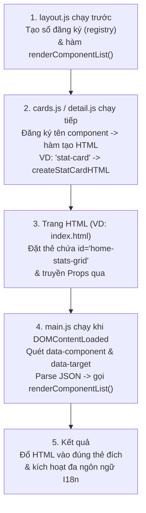
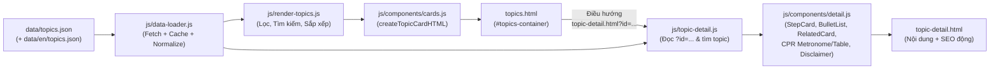

# Kiến trúc Tổ chức Mã nguồn & Cơ chế Tái sử dụng Component (MedFA)

> **Tóm tắt nhanh (30 giây):**
> - Dự án không lặp lại HTML giữa các trang mà tách thành **3 tầng rõ ràng**: **Trang HTML** (khai báo khung & dữ liệu riêng) → **Pure Component (`js/components/`)** (chỉ nhận dữ liệu và trả về HTML) → **Bộ điều phối (`js/main.js`, `js/render-topics.js`, `js/topic-detail.js`)** (nối dữ liệu vào component và bơm ra DOM).
> - Toàn bộ component được chia thành **3 module theo phạm vi trang** (`layout.js`, `cards.js`, `detail.js`) để trang nào chỉ tải đúng mã mình cần.
> - Chỉ có **1 trang `topic-detail.html` duy nhất** phục vụ cả 33 tình huống sơ cấp cứu, tự động ẩn/hiện các thành phần đặc thù (như bộ đếm nhịp và bảng thông số CPR) theo từng bài.

---

## 1. Cấu trúc thư mục & Phân tách Module

```text
MedFA---First-Aid-E-learning-Hub/
├── index.html, topics.html, topic-detail.html, ...   # 8 trang HTML chính (khung ngữ nghĩa, SEO & dữ liệu riêng của trang)
├── css/
│   └── medfa.min.css                                 # File CSS hợp nhất & nén
├── data/
│   ├── topics.json                                   # Dữ liệu tình huống sơ cấp cứu (Tiếng Việt)
│   ├── quiz.json                                     # Ngân hàng câu hỏi trắc nghiệm (VI)
│   └── en/
│       ├── topics.json                               # Bản dịch tiếng Anh cho các tình huống
│       └── quiz.json                                 # Bản dịch tiếng Anh cho bài trắc nghiệm
└── js/
    ├── components/           # Tầng Pure UI Components (phân tách theo phạm vi sử dụng)
    │   ├── layout.js         # Header, Footer + Chatbot AI, escapeHTML, Component Registry
    │   ├── cards.js          # Các Pure Card Components, Emergency 115 Banner, ECG SVG
    │   └── detail.js         # CPR Metronome, CPR Table, Medical Disclaimer, Step/Bullet/Related
    ├── main.js               # Bộ điều phối toàn cục (Hydrator, Navigation, Scroll, Chatbot)
    ├── data-loader.js        # Tải & cache JSON (topics.json + en/topics.json), tìm kiếm không dấu
    ├── render-topics.js      # Logic lọc, tìm kiếm, sắp xếp và render danh sách trên topics.html
    ├── topic-detail.js       # Logic định tuyến ?id=..., đổ dữ liệu chi tiết, SEO động, gắn widget CPR
    ├── translations.js       # Từ điển đa ngôn ngữ (VI / EN) cho giao diện tĩnh
    ├── i18n.js               # Bộ chuyển đổi ngôn ngữ theo thuộc tính data-i18n
    ├── seo-config.js         # Cập nhật canonical, Open Graph, Breadcrumb JSON-LD & nguồn y khoa
    └── chatbot-gemini.js     # Trợ lý AI sơ cấp cứu (Gemini API + quy tắc ngoại tuyến)
```

### Bảng phân tách 3 module trong `js/components/`

| File module | Quy mô | Chức năng chính | Các trang nạp |
| :--- | :--- | :--- | :--- |
| `js/components/layout.js` | ~468 dòng | `HEADER_HTML`, `FOOTER_HTML` (+ Chatbot AI), `escapeHTML`, `registerComponent`, `renderComponentList` | Cả 8 trang HTML |
| `js/components/cards.js` | ~263 dòng | Các pure card (`stat-card`, `priority-card`, `featured-topic-card`, `team-card`, `standard-card`, `approach-card`, `topic-card`, `Skeleton`), `EMERGENCY_BANNER_HTML`, `HEARTBEAT_BG_SVG` | `index.html`, `topics.html`, `about.html`, `social-impact.html` |
| `js/components/detail.js` | ~212 dòng | `CPR_METRONOME_HTML`, `CPR_TABLE_HTML`, `MEDICAL_DISCLAIMER_HTML`, `StepCard`, `BulletList`, `RelatedTopicCard` | Chỉ `topic-detail.html` |

### Vì sao tổ chức như vậy giúp tối ưu hiệu năng?
1. **Chia nhỏ theo phạm vi trang (Manual Code Splitting)**: Các trang nhẹ (`quiz.html`, `flashcards.html`, `contact.html`) chỉ nạp duy nhất `layout.js`, không phải tải thừa mã của các thẻ card hay bảng thông số CPR.
2. **Không tốn request `fetch()` HTML thừa**: Toàn bộ template được đóng gói trong JS và cache bởi trình duyệt, tránh chuỗi chờ mạng (network waterfall), tránh redirect `308` trên Vercel `cleanUrls`, hạn chế giật layout (CLS) và chạy tốt kể cả khi mở trực tiếp bằng `file://`.
3. **Đồng nhất `<script defer>` ở cuối `<body>`**: Cả 8 trang đều đặt `<head>` chỉ chứa SEO/Font/CSS và gom toàn bộ `<script defer>` xuống cuối `<body>`. Thuộc tính `defer` giúp trình duyệt tải JS song song (không chặn dựng giao diện) nhưng vẫn thực thi **đúng thứ tự khai báo** (`layout.js` → `cards.js`/`detail.js` → `main.js`) ngay trước `DOMContentLoaded`.

---

## 2. Cơ chế tái sử dụng Component: Trang chính gọi gì và truyền vào gì?



### Ví dụ thực tế từng bước (từ `index.html`)

**Bước 1 — Trang HTML đặt vùng chứa và truyền dữ liệu Props bằng JSON (không chứa code JS xử lý):**

```html
<!-- Vùng chứa (Mount Target) -->
<ul id="home-stats-grid" class="grid grid-cols-1 md:grid-cols-2 lg:grid-cols-3 gap-gutter-lg"></ul>

<!-- Hộp dữ liệu JSON: data-component chỉ định tên component, data-target chỉ định id vùng chứa -->
<script type="application/json" data-component="stat-card" data-target="home-stats-grid">
  [
    {
      "icon": "emergency",
      "value": "> 3.000",
      "descKey": "home.stat1Desc",
      "descDefault": "Ca tai nạn thương tích trung bình mỗi ngày tại Việt Nam"
    }
  ]
</script>

<!-- Nạp đúng các module cần thiết theo thứ tự -->
<script src="js/components/layout.js" defer></script>
<script src="js/components/cards.js" defer></script>
<script src="js/main.js" defer></script>
```

> *Lưu ý:* Thẻ `<script type="application/json">` **không được trình duyệt chạy như JavaScript** — nó chỉ là hộp chứa dữ liệu JSON hợp lệ chuẩn HTML5 để `js/main.js` đọc vào.

**Bước 2 — `js/components/cards.js` định nghĩa Pure Component và đăng ký tên vào Registry:**

```javascript
function createStatCardHTML(props) {
  return `<li class="...">
    <span class="material-symbols-outlined">${escapeHTML(props.icon)}</span>
    <div>${escapeHTML(props.value)}</div>
    <p data-i18n="${escapeHTML(props.descKey)}">${escapeHTML(props.descDefault)}</p>
  </li>`;
}
host.registerComponent('stat-card', createStatCardHTML);
```

**Bước 3 — `js/main.js` tự động nối dữ liệu với component tương ứng:**

```javascript
document.querySelectorAll('script[type="application/json"][data-component][data-target]').forEach(scriptEl => {
  const componentName = scriptEl.getAttribute('data-component'); // "stat-card"
  const targetEl = document.getElementById(scriptEl.getAttribute('data-target')); // #home-stats-grid
  const items = JSON.parse(scriptEl.textContent || '[]');
  window.MedFAComponents.renderComponentList(componentName, targetEl, items);
});
```

### Bảng ánh xạ đầy đủ các Component & Nguồn dữ liệu

| Thành phần giao diện | Vị trí gắn trên HTML | Module & Hàm trong `js/components/` | Nguồn dữ liệu (Props) |
| :--- | :--- | :--- | :--- |
| **Header & Menu Mobile** | `#header-placeholder` (8 trang) | `layout.js` → `HEADER_HTML` | Trạng thái active từ `body[data-page]` + `translations.js` |
| **Footer & Floating AI Chatbot** | `#footer-placeholder` (8 trang) | `layout.js` → `FOOTER_HTML` | Layout dùng chung + `translations.js` + `seo-config.js` |
| **Banner Gọi 115 khẩn cấp** | `#emergency-banner-placeholder` (`topics.html`) | `cards.js` → `EMERGENCY_BANNER_HTML` | `translations.js` |
| **SVG nền nhịp tim ECG** | `data-component="heartbeat-bg"` (`index.html`, `social-impact.html`) | `cards.js` → `HEARTBEAT_BG_SVG` | Không cần props |
| **Thẻ Thống kê / Ưu tiên / Nổi bật** | `#home-stats-grid`, `#home-priority-situations`, `#home-featured-topics` | `cards.js` → `stat-card`, `priority-card`, `featured-topic-card` | JSON props tại `index.html` |
| **Thẻ Thành viên / Tiêu chuẩn y khoa** | `#about-team-grid`, `#about-standards-grid` | `cards.js` → `team-card`, `standard-card` | JSON props tại `about.html` |
| **Thẻ Giải pháp cộng đồng** | `#impact-approach-grid` | `cards.js` → `approach-card` | JSON props tại `social-impact.html` |
| **Thẻ tình huống & Skeleton** | `#topics-container` (`topics.html`) | `cards.js` → `createTopicCardHTML()`, `createSkeletonCardsHTML()` | `data/topics.json` (+ `data/en/topics.json`) qua `js/data-loader.js` |
| **Các bước sơ cứu, Nên/Tránh, Bài liên quan** | `#detail-steps-container`, `#detail-dos-list`, `#detail-donts-list`, `#related-topics-grid` | `detail.js` → `createStepCardHTML()`, `createBulletListHTML()`, `createRelatedTopicCardHTML()` | Object `topic` theo `?id=...` trong `js/topic-detail.js` |
| **Widget CPR 110 BPM & Bảng thông số CPR/AED** | `#cpr-metronome-slot`, `#cpr-table-slot` (`topic-detail.html`) | `detail.js` → `CPR_METRONOME_HTML`, `CPR_TABLE_HTML` | Chỉ bơm vào DOM khi `isCprTopic(topic) === true` |
| **Lưu ý y khoa & Nguồn tham khảo** | `#medical-disclaimer` (`topic-detail.html`) | `detail.js` → `MEDICAL_DISCLAIMER_HTML` | `topic.sources` qua `js/topic-detail.js` |

---

## 3. Cơ chế hoạt động của `topics.html` và `topic-detail.html`



### A. Trang Thư viện tình huống (`topics.html` + `js/render-topics.js`)
1. Khi tải trang, `TopicsRenderer.init()` hiển thị ngay 6 thẻ Skeleton (`createSkeletonCardsHTML(6)`) để chống giật layout (CLS).
2. Gọi `DataLoader.loadTopics()` lấy toàn bộ danh sách từ `data/topics.json` (tự động gộp bản dịch tiếng Anh từ `data/en/topics.json` nếu đang chọn ngôn ngữ `en`).
3. Xử lý đồng bộ 3 thao tác: **lọc danh mục** (`.category-btn`), **tìm kiếm không dấu** (`DataLoader.normalizeText`), và **sắp xếp** (`#sort-select`).
4. Dùng `createTopicCardHTML(topic)` để render lưới thẻ; mỗi thẻ điều hướng tới `topic-detail.html?id=<topic.id>`.

### B. Trang Chi tiết tình huống (`topic-detail.html` + `js/topic-detail.js`)
Toàn bộ 33 tình huống dùng chung **1 trang khung duy nhất**:
1. **Đọc `id` từ URL** (`URLSearchParams`) → tìm đúng object `topic` trong `DataLoader.loadTopics()`.
2. **Cập nhật SEO động**: `<title>`, `<meta name="description">`, `canonical`, Open Graph và JSON-LD (`MedicalWebPage` + `HowTo` + `BreadcrumbList`).
3. **Đổ dữ liệu vào DOM**: Gán tiêu đề, mô tả, cảnh báo 115, danh mục, thời gian đọc; đồng thời gọi các hàm trong `js/components/detail.js` để render các bước xử lý, Nên/Cần tránh, 3 tình huống liên quan và Lưu ý y khoa.
4. **Render có điều kiện (Conditional Mounting)**:
   - Hàm `isCprTopic(topic)` kiểm tra bài hiện tại có liên quan đến ép tim/CPR hay không. Chỉ khi đúng mới gắn `CPR_METRONOME_HTML` (Web Audio API 110 BPM) và `CPR_TABLE_HTML` vào `#cpr-metronome-slot` & `#cpr-table-slot`. Các bài khác giữ 2 slot trống và ẩn hoàn toàn.
   - `#choking-timeline` chỉ hiện khi có `topic.timeline`; `#detail-video-section` chỉ hiện khi có `topic.video.youtubeUrl` hợp lệ.

---

## 4. So sánh với mô hình React Component

Kiến trúc của MedFA áp dụng các tư duy cốt lõi của **React** (và hướng tách tải từng phần giống **Astro Islands**) nhưng viết hoàn toàn bằng **Vanilla JavaScript thuần**:

| Khía cạnh kỹ thuật | React Component | MedFA Vanilla JS Component |
| :--- | :--- | :--- |
| **Pure Component** | `function StatCard(props) { return <li>...</li>; }` | `function createStatCardHTML(props) { return '<li>...</li>'; }` |
| **Truyền Props** | JSX attributes: `<StatCard icon="emergency" />` | `<script type="application/json" data-component="stat-card" data-target="...">` hoặc object từ `DataLoader` |
| **List Rendering** | `items.map(item => <Card key={item.id} {...item} />)` | `items.map(createCardHTML).join('')` qua `renderComponentList()` |
| **Conditional Rendering** | `{isCpr && <CprMetronome />}` | `if (isCprTopic(topic)) { slot.innerHTML = CPR_METRONOME_HTML; }` |
| **Code Splitting** | `React.lazy(() => import('./Detail'))` | Tách 3 file `layout.js`, `cards.js`, `detail.js` — trang nào cần mới nạp |
| **Chống XSS** | Tự động escape `{value}` trong JSX | Escape tường minh qua `escapeHTML(props.value)` |
| **Build & Runtime** | Cần Node.js + Vite/Webpack, có Virtual DOM | **0 build step**, 0 thư viện ngoài, chạy trực tiếp trên trình duyệt và `file://` |

---

## 5. Tra cứu nhanh cho thành viên nhóm

| Nhu cầu chỉnh sửa | Mở file nào? | Ghi chú |
| :--- | :--- | :--- |
| Sửa menu, logo, ngôn ngữ, Footer, khung Chatbot | `js/components/layout.js` | Tự cập nhật trên cả 8 trang |
| Sửa giao diện (HTML/CSS) của các loại thẻ Card hoặc Banner 115 | `js/components/cards.js` | Không chứa dữ liệu cứng |
| Sửa bảng thông số CPR, bộ đếm nhịp 110 BPM, hoặc Lưu ý y khoa | `js/components/detail.js` | Chỉ ảnh hưởng `topic-detail.html` |
| Thay đổi chữ/số liệu của các thẻ trên Trang chủ / Giới thiệu / Tác động xã hội | Mảng JSON trong `index.html`, `about.html`, `social-impact.html` | Không cần đụng vào file JS |
| Thêm hoặc sửa nội dung một tình huống sơ cấp cứu | `data/topics.json` (và `data/en/topics.json`) | Không cần tạo thêm file HTML mới |
| Thêm bản dịch giao diện (VI / EN) | `js/translations.js` | Khớp với thuộc tính `data-i18n` |
| **Lưu ý bảo mật (XSS)** | Mọi hàm trong `js/components/*.js` | Luôn bọc dữ liệu động qua `escapeHTML()` |
